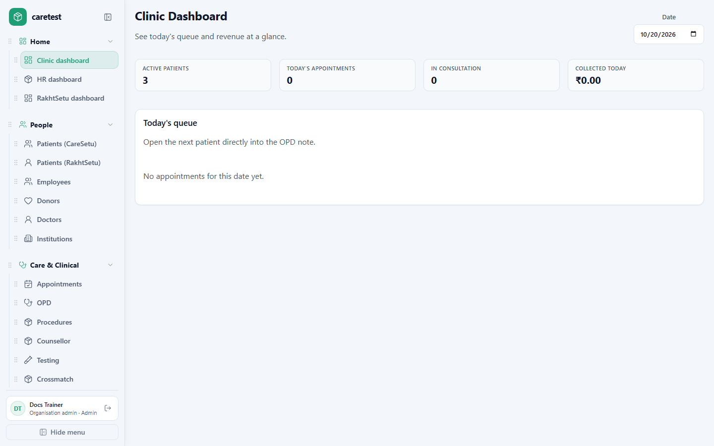

# HealthSetu Help & Training

Welcome. This site is the **client go-to** for HealthSetu — how your clinic, blood bank, hospital, or organisation uses the product day to day.

Use it for:

- **Education** — what each module does and who it is for
- **Training** — step-by-step for receptionists, nurses, doctors, lab staff, HR, and store
- **Everyday reference** — “how do I…?” while you work

> This is not the engineering design pack. It is written for **staff and clinicians** who open HealthSetu every morning.

## What we provide

HealthSetu is a multi-module platform for Indian healthcare organisations. Your organisation turns on the modules you need. Staff sign in once and work from a shared portal.

  <a class="module-card" href="#/core/overview">
    <strong>Core</strong>
    Organisation login, users & roles, inbox, barcodes, email, WhatsApp, and branding.
  </a>
  <a class="module-card" href="#/rakhtsetu/overview">
    <strong>RakhtSetu</strong>
    Blood bank: donors, camps, collection, processing, testing, issue & QC.
  </a>
  <a class="module-card" href="#/supplysetu/overview">
    <strong>SupplySetu</strong>
    Catalog, stock, assets, vendors, purchase orders, daily QC checklists.
  </a>
  <a class="module-card" href="#/hrsetu/overview">
    <strong>HRSetu</strong>
    Employees, attendance, leave, salary, training, and self-service My HR.
  </a>
  <a class="module-card" href="#/caresetu/overview">
    <strong>CareSetu</strong>
    Clinic OPD: patients, appointments, doctor visit, procedures, counsellor, billing.
  </a>
  <a class="module-card" href="#/swasthasetu/overview">
    <strong>SwasthaSetu</strong>
    Occupational health centre: pre-employment and periodic exams, OHC OPD, safety checks.
  </a>
  <a class="module-card" href="#/security/overview">
    <strong>Security &amp; compliance</strong>
    Own database per organisation, no cross-contamination, hosted on Microsoft Azure.
  </a>

  <strong>For owners and IT:</strong> each organisation gets a <strong>dedicated database</strong> so another customer’s data cannot mix with yours — and the platform runs on <strong>Microsoft Azure</strong>.
  Read <a href="#" data-hs-route="security/overview">Security &amp; compliance</a>,
  <a href="#" data-hs-route="security/tenant-isolation">tenant isolation</a>, and
  <a href="#" data-hs-route="security/azure-cloud">Azure hosting</a>.

## How to use this site

1. Open the **left menu** (same idea as the product sidebar).
2. Start with [Getting started](#/getting-started/overview) if you are new.
3. **Owners / first setup:** print [Before you start (paper & Excel)](#/getting-started/before-you-start) before opening Hospital setup.
4. Jump to your module, then the screen you use most.
5. Use **Search** (top of the sidebar) for a keyword such as “crossmatch” or “leave”.

  <strong>Tip for trainers:</strong> Walk a new joiner through <a href="#" data-hs-route="getting-started/by-role">Guides by role</a>, then the three pages they will open every day.
  For a new hospital, start with <a href="#" data-hs-route="getting-started/before-you-start">Before you start</a> — paper first, then Excel, then software.

## Media

Pages include **screenshots** from a demo organisation and **video placeholders** for short training clips. To add or refresh media, see [How to add screenshots & videos](#/assets/media-guide).

<figure class="media-frame media-frame--image">
  
  <figcaption>The left menu is grouped into Home, People, Care &amp; Clinical, Operations, Insights &amp; Reports, Administration, and My Work. You see only the screens your role allows.</figcaption>
</figure>

## Need help beyond this site?

Ask your organisation administrator, or contact your HealthSetu support channel. Do not share passwords or patient identifiers in public tickets.
